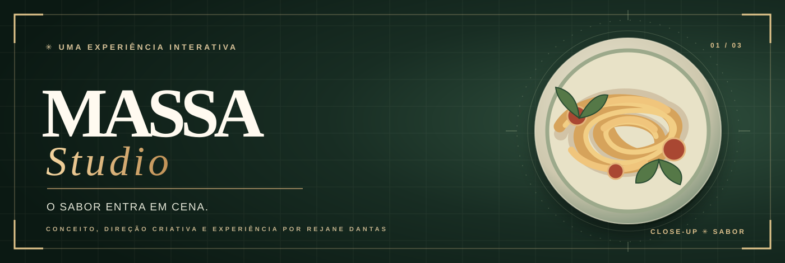

<p align="center">
  
</p>

<h1 align="center">Massa Studio 🍝</h1>

<p align="center">
  <strong>Um cardápio que não começa com uma lista. Começa com uma experiência.</strong><br />
  Protótipo autoral de cardápio digital com direção criativa cinematográfica, personalização e jornada de compra interativa.
</p>

<p align="center">
  <a href="https://massa-studio-rejane.peakedglade4.chatgpt.site"><strong>🎬 EXPERIMENTAR O CARDÁPIO</strong></a>
  &nbsp; • &nbsp;
  <a href="#o-conceito">O conceito</a>
  &nbsp; • &nbsp;
  <a href="#como-experimentar-localmente">Executar localmente</a>
</p>

<p align="center">
  
  
  
  
</p>

---

## ✨ O conceito

E se escolher o jantar fosse tão envolvente quanto assistir à abertura de um filme?

O **Massa Studio** nasceu dessa pergunta. Em vez de apresentar produtos de forma estática, o projeto convida a pessoa a descobrir cada prato, conhecer sua história e construir o pedido com liberdade. Cada animação tem uma intenção: **despertar curiosidade, facilitar a escolha e valorizar o produto**.

É um laboratório de experiência digital pensado para restaurantes, mas com ideias que podem inspirar catálogos e vitrines interativas em outros segmentos.

## 🎞️ Uma jornada em seis cenas

| Cena | O que acontece | Por que existe |
| --- | --- | --- |
| **01 — Abertura** | Fotografias entram uma a uma, ocupam a tela e se dispersam. | Criar impacto e curiosidade logo no primeiro contato. |
| **02 — Exploração** | Galeria em movimento e filtros por categoria. | Deixar a navegação convidativa e simples. |
| **03 — Descoberta** | A foto amplia e, com outro toque, o cartão vira para contar a história do prato. | Dar contexto e valor à escolha. |
| **04 — Personalização** | Tamanho, massa, molho e adicionais atualizam o preço na hora. | Dar autonomia e transparência ao cliente. |
| **05 — Combinações** | Bebida e pão entram como sugestões; depois, a sobremesa. | Apresentar complementos no momento certo, sem obrigar a compra. |
| **06 — Sacola** | Quantidades, observações e subtotal são organizados automaticamente. | Tornar o pedido fácil de revisar. |

<p align="center">
  <a href="https://massa-studio-rejane.peakedglade4.chatgpt.site"><strong>▶ Ver a experiência funcionando</strong></a>
</p>

## 🧩 Funcionalidades

- Abertura cinematográfica com opção de **pular** ou **rever**;
- Fotos interativas com efeito de ampliação e **virada 3D**;
- Montagem de massas com **cálculo automático de valores**;
- Sugestões de acompanhamentos, bebidas e sobremesas;
- Cardápio com filtros por categoria;
- Sacola com controle de quantidade, subtotal e observações;
- Persistência da sacola no próprio navegador (`localStorage`);
- Layout adaptado para telas pequenas e grandes, com respeito à preferência por movimento reduzido.

## 🛠️ Como experimentar localmente

Este é um projeto estático, sem instalação de dependências ou serviço de backend.

```bash
git clone https://github.com/rejanedantas95-star/massa-studio..git massa-studio
cd massa-studio
python3 -m http.server 4173 --directory dist
```

Depois, abra `http://localhost:4173` no navegador. Também é possível abrir `dist/index.html` diretamente.

```text
dist/
├── index.html    # Estrutura do cardápio
├── styles.css    # Identidade visual
├── cinema.css    # Coreografia e efeitos
└── app.js        # Produtos, interações e sacola
```

Para personalizar produtos, imagens e valores, edite a lista `MENU` em `dist/app.js`. Para ativar um destino de pedidos, configure `CONFIG.whatsapp` com o número de atendimento autorizado.

## 🎨 Autoria e processo criativo

**Rejane Dantas** — conceito, direção criativa, estrutura da experiência, definição de funcionalidades, testes e refinamento.

O desenvolvimento foi realizado **com apoio de inteligência artificial**, a partir de orientações, decisões e validações da autora. O foco é transformar necessidades reais de atendimento e negócios em soluções digitais intuitivas, úteis e memoráveis.

## 📌 Sobre esta demonstração

O Massa Studio é um **projeto conceitual independente**, sem vínculo com restaurantes reais. Produtos, preços e combinações são demonstrativos. As fotografias ilustrativas são carregadas do Unsplash e devem ser substituídas por imagens licenciadas ou próprias antes do uso comercial.

Não há cobrança, pagamento ou transmissão automática de pedidos. Sem um WhatsApp configurado, a finalização oferece um resumo para copiar.

---

<p align="center">
  <strong>Da ideia à experiência. Do primeiro toque à última cena.</strong><br />
  © 2026 Rejane Dantas · Projeto autoral de portfólio.
</p>
